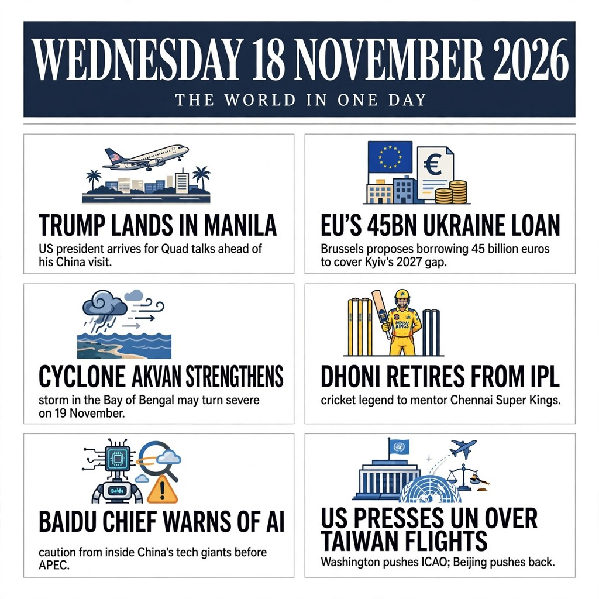

# The World in One Day — 18 November 2026

A one-page summary of the world's news of **Wednesday 18 November 2026**, built by an AI agent for make.fun's [news-image-20261118](https://make.fun/bounty/news-image-20261118) bounty ($250 in USDC).

## The six stories

1. **Trump Lands in Manila** — US president arrives for Quad talks ahead of his China visit.
2. **EU's €45bn Ukraine Loan** — Brussels proposes borrowing €45 billion to cover Kyiv's 2027 gap.
3. **Cyclone Akvan Strengthens** — Storm in the Bay of Bengal may turn severe on 19 November.
4. **Dhoni Retires from IPL** — Cricket legend to mentor Chennai Super Kings.
5. **Baidu Chief Warns of AI Bubble** — Caution from inside China's tech giants before APEC.
6. **US Presses UN over Taiwan Flights** — Washington pushes ICAO; Beijing pushes back.

## How it works

`main.ts` copies the pre-rendered image (`entry.png`, JPEG bytes) to the output directory. No network, no randomness — every run writes the same bytes.

Sources: Jagran Josh, Education Times, Pollar News, Traders Union, The Daily Jagran (see the research notes in the build log).
